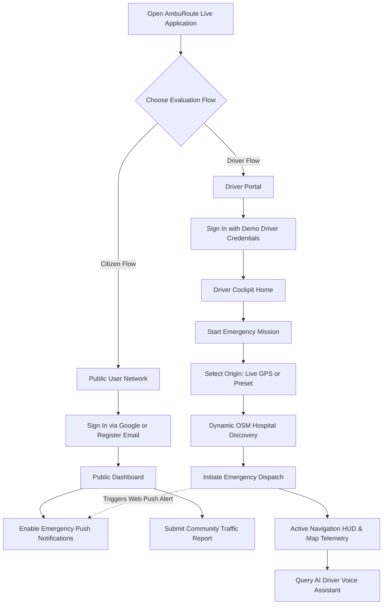
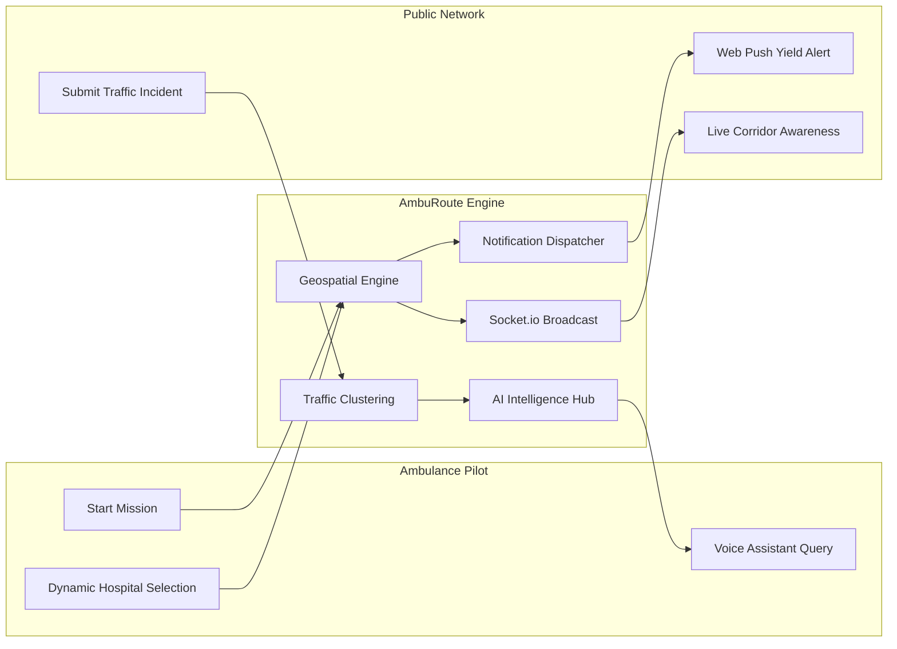
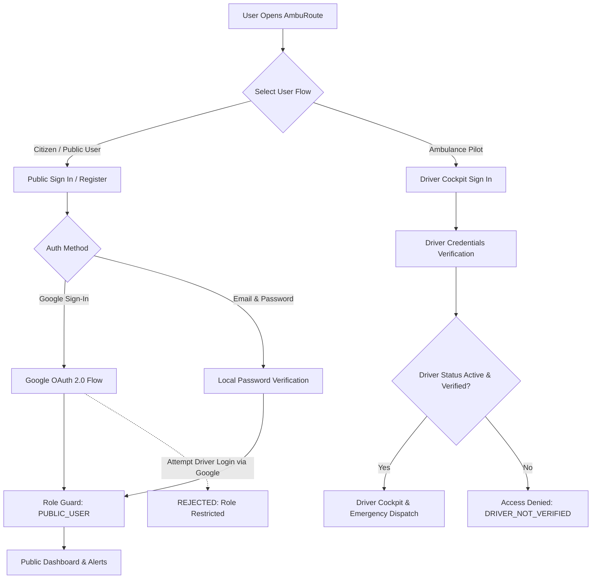
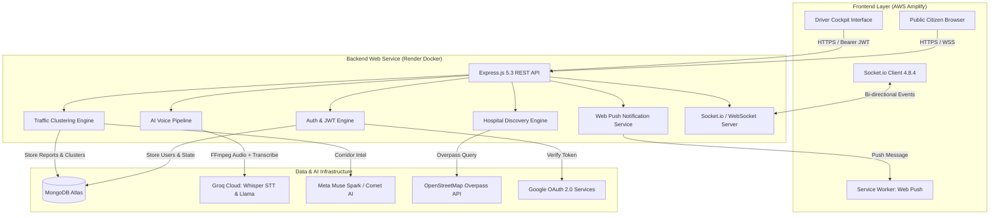
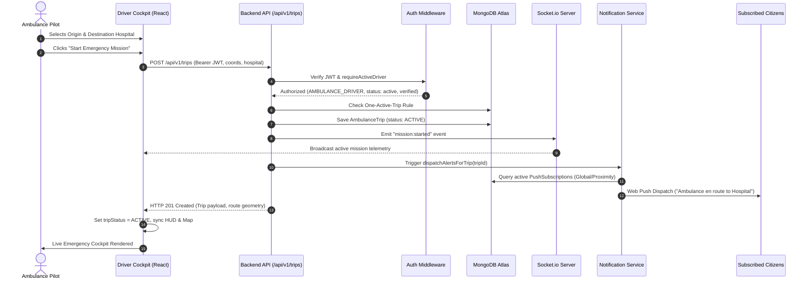
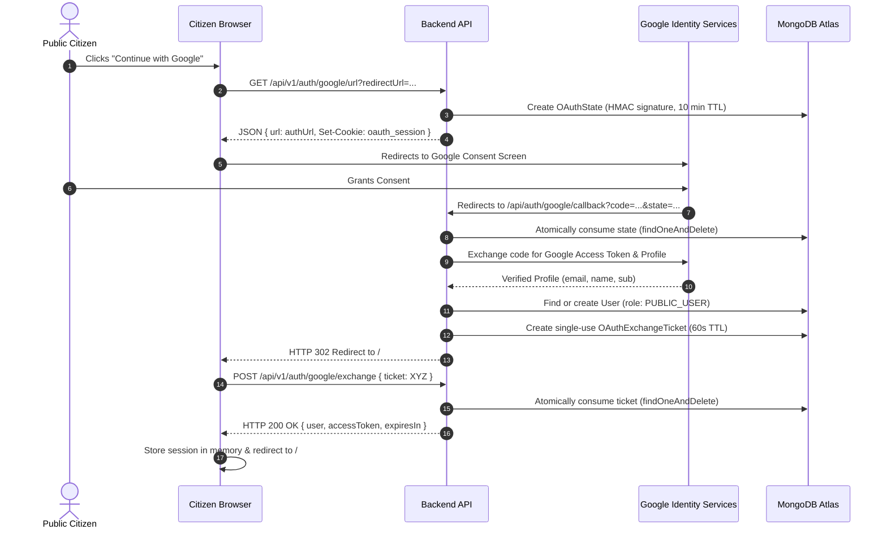
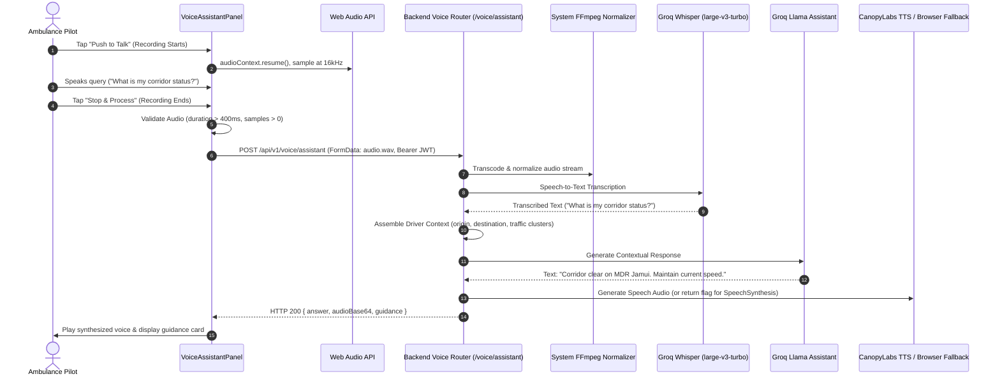
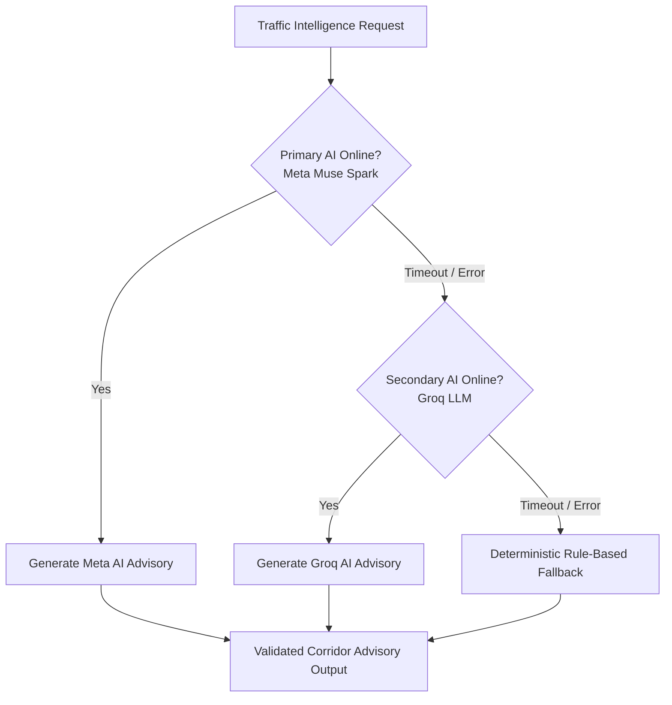
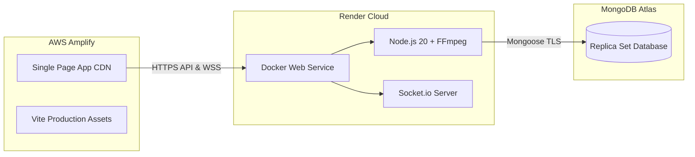

# AmbuRoute

> **AI-Powered Emergency Ambulance Coordination & Real-Time Road Awareness Platform**

[](https://react.dev/)
[](https://nodejs.org/)
[](https://expressjs.com/)
[](https://socket.io/)
[](https://www.mongodb.com/)
[](https://www.docker.com/)
[](https://main.d37a0y0p7v19sh.amplifyapp.com)
[](LICENSE)

---

## 🚀 Try AmbuRoute Live

Experience the deployed AmbuRoute application directly through your browser. The live demo provides full access to both the public-user experience and the authorized ambulance-driver workflow.

### 👉 [Open AmbuRoute Live Application](https://main.d37a0y0p7v19sh.amplifyapp.com/)

> [!NOTE]
> AmbuRoute runs as a responsive progressive web application. You can test both user roles in two separate browser tabs or side-by-side across mobile and desktop.

---

## 🎯 Complete Live Demo Guide for Judges

Welcome hackathon judges! This section guides you through the live interactive features of AmbuRoute. Everything described below is deployed, connected to our cloud database and AI services, and fully functional.

### What Judges Can Explore

| Feature Category | Description | Primary User Role | Key Technologies |
|---|---|---|---|
| **Public User Network** | View active emergency corridors, subscribe to route-aware push alerts, and submit real-time road conditions. | `PUBLIC_USER` | React 19, Leaflet Maps, Web Push / VAPID |
| **Google Authentication** | One-click verified login and automated account linking for citizens via Google OAuth 2.0. | `PUBLIC_USER` | Google Identity, Single-use OAuth Tickets |
| **Driver Cockpit & Dispatch** | Authenticate as an emergency pilot, select trip origin, dynamically discover nearby trauma centers, and activate a mission. | `AMBULANCE_DRIVER` | JWT RBAC, OSM Overpass QL, Socket.io |
| **Dynamic Hospital Discovery** | Real-time geospatial hospital query discovering the closest emergency facilities with distance metrics. | `AMBULANCE_DRIVER` | OpenStreetMap Overpass, Haversine Distance |
| **Emergency Push Dispatch** | Automated Web Push notifications alerting citizens along the corridor within a 500m radius of approaching units. | All Users | Service Worker API, web-push, VAPID |
| **AI Driver Voice Assistant** | Hands-free driver voice interaction: tap to ask traffic, hospital, or trip queries with natural-language audio guidance. | `AMBULANCE_DRIVER` | Groq Whisper STT, Llama AI, Web Audio API |
| **Community Traffic Intelligence**| Spatial and temporal clustering of road observations with multi-provider AI corridor syntheses. | All Users | Haversine Clustering, Meta AI / Groq Fallback |
| **Real-Time Telemetry Sync** | Live bi-directional mission state and GPS transit synchronization across connected clients. | All Users | Socket.io 4.8.4, WebSocket Engine |

---

### Quick Flow Diagram for Judges



---

### Demo Ambulance Driver Account

AmbuRoute enforces strict Role-Based Access Control (RBAC). To access the **Driver Portal & Emergency Cockpit**, use this pre-seeded evaluation account:

| Field | Demo Credential |
|---|---|
| **Portal Link** | Top Navigation → **Driver Portal** (or `#driver`) |
| **Email** | `driver@amburoute.demo` |
| **Password** | `Password@123` |
| **Assigned Unit** | `Patna Emergency 108 — Alpha` (`BR-01-EA-108`) |
| **Pilot in Command** | `Amitabh Sen` |

> [!IMPORTANT]
> **Safety & Sandboxing Confirmation:** This demo driver credential is an isolated, pre-seeded demonstration account created strictly for hackathon evaluation and testing. It operates entirely within the isolated AmbuRoute demo database and does not connect to municipal 911/108 dispatch systems.

---

### Hospital Participation & Hospital Login Notice

> [!NOTE]
> **Hospital Authentication Status in MVP:** There is **no separate hospital login or hospital dashboard** in this release. 
> 
> In AmbuRoute MVP, hospitals are integrated **geospatially**: ambulance drivers discover nearby hospital bases dynamically via real-time **OpenStreetMap Overpass QL** and distance-filtered regional directories to select their destination. A dedicated hospital ER intake portal (for real-time triage pre-alerts and bed management) is planned for Phase 7 (see [Future Scope](#14-impact--future-scope)).

---

### Step-by-Step Demo Workflows for Judges

#### DEMO 1: Public User Experience & Community Reporting
1. Open the live app: [https://main.d37a0y0p7v19sh.amplifyapp.com](https://main.d37a0y0p7v19sh.amplifyapp.com).
2. Click **Sign In / Register** in the top navigation.
3. Test **Google Sign-In** by clicking **Continue with Google** (instant one-click registration), or create a citizen email account.
4. Once authenticated, explore the **Public Dashboard** (`#public`):
   - Review active community emergency metrics.
   - Click **Enable Emergency Push Notifications** and grant browser permission to test Web Push alerts.
5. In the top navigation, click **Report Traffic**:
   - Choose a road condition: `CLEAR`, `TRAFFIC_HIGH`, `ROAD_BLOCKED`, or `CANNOT_ASSESS`.
   - Add a brief note (e.g., *"Tree branch partially blocking left lane"*) and submit.
   - Notice your report is immediately clustered and corroborated by the backend.

---

#### DEMO 2: Ambulance Driver Experience & Emergency Dispatch
1. In an incognito window or separate browser tab, navigate to the **Driver Portal** (`#driver/login`).
2. Log in with the demo driver credentials:
   - **Email:** `driver@amburoute.demo`
   - **Password:** `AmbuRoute@Demo2026`
3. The **Driver Cockpit** displays pilot **Amitabh Sen** and vehicle **Patna Emergency 108 — Alpha**.
4. In the sidebar, click **Start Emergency**:
   - **Step 1: Set Origin:** Click **Use My Live Location** (or choose a preset like *Lakhisarai Station*).
   - **Step 2: Dynamic Hospital Discovery:** AmbuRoute instantly queries OpenStreetMap Overpass around your coordinates, displaying the 3 closest emergency hospitals with calculated aerial distances.
5. Select a destination hospital (e.g., *PMCH Emergency Trauma Center* or *Sadar Hospital Jamui*).
6. Click **Start Emergency Mission**:
   - The interactive **Navigation HUD** opens, rendering the emergency beacon, live transit speed, estimated ETA, and geographic corridor map.
   - An active emergency banner appears globally across the application.

---

#### DEMO 3: Emergency Notification Workflow (Two-Device / Two-Profile Setup)
To observe real-time emergency alerting between vehicle and community:
1. **Device / Tab A (Citizen):** Follow Demo 1 and subscribe to push notifications on the Public Dashboard. Keep this tab open.
2. **Device / Tab B (Driver):** Follow Demo 2 and initiate an emergency mission.
3. **Observe the Result:** 
   - Tab A immediately receives a Web Push yield notification (*"Ambulance 108 en route to PMCH — Please yield right"*).
   - In Tab B (Driver Cockpit), complete or end the trip by clicking **End Emergency**.
   - Tab A updates dynamically via Socket.io and dismissed status banners.

---

#### DEMO 4: AI Driver Voice Assistant (Hands-Free Cockpit)
1. In the active **Driver Cockpit**, locate the **AI Driver Voice Assistant** panel on the right.
2. Click the green **Push to Talk (AI Mic)** button and grant microphone permission if prompted.
3. Speak an emergency transit query, for example:
   - *"What is my corridor status?"*
   - *"Is there traffic ahead on the route?"*
   - *"Which destination hospital are we heading to?"*
   - *"What is the shortest route?"*
4. Click **Stop & Process** (or let it finalize).
5. **Observe:** The assistant sends your audio to Groq Whisper (`whisper-large-v3-turbo`), injects live mission and traffic context, generates a targeted advisory, displays a visual guidance card, and provides clear audio playback.

---

## Table of Contents

1. [Executive Summary](#1-executive-summary)
2. [The Real-World Problem](#2-the-real-world-problem)
3. [Our Solution: How AmbuRoute Works](#3-our-solution-how-amburoute-works)
4. [User Roles & Access Control](#4-user-roles--access-control)
5. [Complete System Architecture & Workflows](#5-complete-system-architecture--workflows)
6. [Real-Time Synchronization with Socket.io](#6-real-time-synchronization-with-socketio)
7. [AI-Powered Intelligence in AmbuRoute](#7-ai-powered-intelligence-in-amburoute)
8. [Product Features Breakdown](#8-product-features-breakdown)
9. [Technology Stack](#9-technology-stack)
10. [Project Directory Structure](#10-project-directory-structure)
11. [Local Development Setup Guide](#11-local-development-setup-guide)
12. [Production Deployment Architecture](#12-production-deployment-architecture)
13. [API Documentation Overview](#13-api-documentation-overview)
14. [Security, Privacy & Data Protection](#14-security-privacy--data-protection)
15. [Impact & Future Scope](#15-impact--future-scope)

---

## 1. Executive Summary

**AmbuRoute** is an intelligent emergency transit assistance platform built to close the coordination gap between emergency medical vehicles, surrounding road users, medical facilities, and community traffic observations.

When an emergency ambulance trip is initiated, every second counts. However, ambulances frequently encounter unexpected bottlenecks, delayed yield responses from surrounding drivers who are unaware of an approaching vehicle until the siren is immediately audible, and fragmented road information.

AmbuRoute bridges this divide by providing:
1. **Route-Aware Proximity Alerts:** Web Push notifications that inform participating drivers and citizens ahead of an approaching emergency vehicle.
2. **Dynamic Nearby Hospital Discovery:** Real-time geospatial hospital discovery powered by OpenStreetMap Overpass with aerial distance calculations and verified regional base fallback.
3. **Corroborated Community Traffic Intelligence:** Spatial and temporal clustering of road observations (`CLEAR`, `TRAFFIC_HIGH`, `ROAD_BLOCKED`, `CANNOT_ASSESS`) with multi-provider AI syntheses and deterministic fallbacks.
4. **Hands-Free AI Driver Voice Assistant:** Browser-captured audio transcription via Groq Whisper, contextual trip extraction, Groq AI response generation, and voice playback designed to minimize driver cognitive overload and distraction.
5. **Real-Time Telemetry Broadcasting:** Bi-directional Socket.io / WebSocket telemetry streaming active vehicle positions and trip lifecycle state to connected interfaces with sub-second latency.

---

## 2. The Real-World Problem

### Problem 1: Delayed Yield Reactions & Emergency Corridor Bottlenecks
Motorists and pedestrians on urban corridors often cannot see or hear an approaching ambulance until it is within 50–100 meters, especially with modern sound-insulated cabins, vehicular audio, and dense traffic noise. This creates sudden, panic-induced braking or gridlocked lane blockages where vehicles have no room to merge or yield.

### Problem 2: Fragmented Information Across the Emergency Journey
Ambulance drivers navigate dynamic traffic conditions while monitoring patient stability. Critical route details—such as which medical centers have operational trauma facilities nearby, which intersections are blocked by accidents or construction, and whether alternative lanes are flowing—are fragmented across separate consumer mapping apps that lack emergency-vehicle awareness.

### Problem 3: Unverified & Stale Traffic Reports
Standard crowdsourced transit tools often broadcast unverified single-user observations. A report of a blockage from two hours ago may no longer be relevant, while an active bottleneck may go unreported. AmbuRoute solves this through temporal decay windows (60 minutes) and spatial clustering (1,000m radius) requiring multi-reporter corroboration.

---

## 3. Our Solution: How AmbuRoute Works



1. **Dispatch & Tracking:** A verified ambulance driver signs into the Driver Cockpit, selects their ambulance origin (via live device GPS or interactive map selection), discovers the three closest medical centers, and initiates an emergency mission.
2. **Public Alerting:** The backend creates the active emergency mission and dispatches Web Push yield alerts to participating devices along the corridor, giving road users advance notice to yield calmly.
3. **Crowdsourced Intelligence:** Road users submit observations regarding road blockages, heavy congestion, or clear corridors.
4. **AI Route Assistance:** As the ambulance travels, the driver can tap once to query the AI Voice Assistant for corridor updates, remaining distance, or destination status hands-free.
5. **Real-Time Synchronization:** Active missions and vehicle telemetry are synchronized instantly to all connected public and driver clients via WebSocket/Socket.io channels.

---

## 4. User Roles & Access Control

AmbuRoute implements strict role-based access control (RBAC) enforced by backend JWT verification middleware:

| Role Identifier | Who They Are | Authentication Methods | Permissions & Capabilities | Access Restrictions |
|---|---|---|---|---|
| `PUBLIC_USER` | Citizen, commuter, or pedestrian | Email + Password, Google OAuth | View public dashboard, subscribe to emergency yield push alerts, submit community traffic observations. | **Strictly blocked** from creating trips, accessing driver telemetry, or viewing driver cockpit. |
| `ROAD_USER` | Mobile road subscriber | Email + Password, Web Push Subscription | Submit location heartbeats, receive route-aware push alerts, report road conditions. | **Strictly blocked** from starting trips or accessing driver controls. |
| `AMBULANCE_DRIVER` | Verified ambulance pilot driver | Dedicated Driver Credentials (email/password) | Access Driver Cockpit, discover nearby hospitals, dispatch emergency missions, transmit live GPS updates, interact with AI Voice Assistant, conclude trips. | **Blocked from Google OAuth** (must use hospital-verified credentials). Cannot access administrative systems. |
| `ADMIN` | System administrator | Verified administrative credentials | Platform telemetry monitoring, emergency fleet management, system-wide diagnostics. | Restricted to authenticated operations personnel. |

### Authentication & Role Isolation Flowchart



---

## 5. Complete System Architecture & Workflows

### A. High-Level System Architecture



---

### B. Emergency Mission Dispatch Sequence



---

### C. Google OAuth 2.0 Sequence (Public Users Only)



---

### D. Hands-Free AI Voice Assistant Sequence



---

## 6. Real-Time Synchronization with Socket.io

AmbuRoute incorporates **Socket.io 4.8.4** alongside standard REST APIs and Web Push protocols to provide sub-second bi-directional telemetry synchronization between emergency ambulances and connected clients:

### How Socket.io Operates in AmbuRoute:
1. **Live GPS Coordinate Streaming:** As the ambulance pilot navigates, location updates are emitted to the WebSocket server and broadcast to monitoring dashboards, eliminating polling latency.
2. **Mission Lifecycle Synchronization:** When a driver activates or concludes an emergency mission, a `mission:started` or `mission:ended` event is instantly published across the socket room, keeping the top emergency banner in sync on all active clients.
3. **Resilient Reconnection:** The Socket.io client automatically manages reconnections, exponential backoffs, and fallback polling should cellular network coverage degrade during transit.
4. **Bandwidth Optimization:** High-frequency GPS updates are transmitted over low-overhead binary/JSON socket frames rather than heavier repeated HTTP headers.

---

## 7. AI-Powered Intelligence in AmbuRoute

### A. AI Driver Voice Assistant
- **Provider & Model:** Groq Cloud running `whisper-large-v3-turbo` for speech recognition and `openai/gpt-oss-20b` for natural language reasoning.
- **Audio Pre-Processing:** Browser audio is captured via standard 16 kHz PCM recording. Backend normalizes streams via system FFmpeg before passing to Whisper.
- **Context Injection:** When the driver asks a question, the assistant automatically loads:
  - Driver unit call sign and vehicle plate number.
  - Active trip destination hospital and distance remaining.
  - Recent community traffic incident clusters along the corridor.
- **Driver Distraction Mitigation:** Responses are constrained to concise, one-to-two sentence emergency transit updates.
- **Audio Fallback:** CanopyLabs Orpheus TTS is queried first; if unavailable, the frontend seamlessly uses native browser `window.speechSynthesis`.

### B. Corroborated Community Traffic Intelligence
- **Incident Reporting:** Road users submit reports classified as `CLEAR`, `TRAFFIC_HIGH`, `ROAD_BLOCKED`, or `CANNOT_ASSESS`.
- **Spatial & Temporal Clustering:** Reports within a **1,000-meter radius** submitted within a **60-minute active window** are automatically clustered using Haversine formulas.
- **Corroboration Threshold:** Clusters require at least **3 distinct reporters** before receiving high confidence.
- **AI Corridor Summaries:** The cluster intelligence service queries Meta Muse Spark (`muse-spark-1.3`) or Groq AI to formulate natural-language corridor traffic advisories.

### C. Multi-Tier AI Fallback Architecture



- If external AI APIs fail or rate limit, AmbuRoute **never fabricates estimates**. It gracefully falls back to deterministic rule-based assessments (`"3 independent reports confirm road blockage near corridor checkpoint"`).

---

## 8. Product Features Breakdown

### Ambulance Pilot Features
- **Secure Driver Authentication:** Protected with bcrypt password hashing and JWT token validation.
- **Dynamic Hospital Discovery:** Discovers the 3 closest medical facilities based on real-time ambulance coordinates.
- **Interactive Origin Selection:** Option A (Live Device GPS with accuracy radius) or Option B (Interactive Map click).
- **Live Emergency Cockpit:** Navigation HUD displaying current speed, ETA, destination hospital, and corridor telemetry.
- **Hands-Free Voice Assistant:** Tap-to-toggle voice queries with live audio level metering and audio pre-flight validation.
- **One-Active-Trip Enforcement:** Guarantees telemetry integrity by preventing concurrent active trips for the same driver.

### Public Citizen Features
- **Google Sign-In & Registration:** Instant public onboarding via Google OAuth 2.0 authorization code flow.
- **Route-Aware Web Push Notifications:** Browser push notifications informing citizens when an emergency ambulance is en route.
- **Community Traffic Reporting:** Report road conditions with automatic geolocation tagging.
- **Live Public Dashboard:** Real-time visibility into emergency vehicles in transit across the community.

### Backend Infrastructure Features
- **Dynamic CORS Engine:** Strict origin allowlisting supporting both production AWS Amplify and local development.
- **Token Revocation Map:** Immediate token invalidation on logout with automatic scheduled cleanup.
- **Anti-Collision JWTs:** Unique `jti` UUIDs embedded in all signed tokens to prevent revocation collisions.
- **Single-Use OAuth Tickets:** Short-lived (60s) MongoDB tickets that prevent JWT tokens from leaking into browser history.

---

## 9. Technology Stack

| Layer | Technology | Version | Purpose in AmbuRoute |
|---|---|---|---|
| **Frontend Framework** | React | `19.0.0` | UI component architecture and state management |
| **Build Tool** | Vite | `8.3.5` | Fast client bundling and environment variable injection |
| **Real-Time Telemetry** | Socket.io | `4.8.4` | Bi-directional WebSocket telemetry and mission synchronization |
| **Mapping Engine** | Leaflet / React-Leaflet | `1.9.4` / `5.0.0` | Interactive geographic corridor and hospital rendering |
| **Audio Processing** | Web Audio API | Native Browser | 16 kHz PCM microphone audio capture and volume metering |
| **Push Notifications** | Service Worker API | Native Browser | Background push notification receipt and notification clicks |
| **Backend Framework** | Express.js | `5.3.0` | High-performance asynchronous REST API routing |
| **Runtime Environment**| Node.js | `20 LTS` | Server-side JavaScript execution environment |
| **Database & ODM** | MongoDB Atlas / Mongoose | `9.11.4` | Document store for users, trips, reports, and OAuth state |
| **Audio Transcoding** | FFmpeg | `5.1.9` | Containerized audio stream normalization for Whisper STT |
| **Speech-to-Text** | Groq Whisper | `large-v3-turbo` | Near-zero latency emergency speech recognition |
| **Voice AI & Chat** | Groq Llama | `gpt-oss-20b` | Contextual driver voice assistant query resolution |
| **Traffic Intelligence**| Meta Muse Spark / Groq | `muse-spark-1.3` | Spatial traffic cluster summarization and corridor advisories |
| **Geospatial Discovery**| OpenStreetMap Overpass | Overpass QL | Real-time dynamic nearby hospital discovery |
| **Identity Provider** | Google OAuth 2.0 | v2 / v3 | Citizen authentication and account linking |
| **Push Protocol** | Web Push / VAPID | `3.6.7` | Voluntary browser-level push notifications |
| **Containerization** | Docker | Bookworm Slim | Reproducible production deployment image |
| **Hosting: Frontend** | AWS Amplify | CI/CD Git | Global CDN static hosting for React single-page app |
| **Hosting: Backend** | Render | Docker Web Service | Containerized Node.js backend execution |

---

## 10. Project Directory Structure

```text
AmbuRoute/
├── backend/
│   ├── config/
│   │   ├── db.js                   # Mongoose MongoDB connection & ready states
│   │   └── env.js                  # Validated environment configuration & defaults
│   ├── middlewares/
│   │   ├── auth.js                 # JWT verification, RBAC, and token revocation map
│   │   ├── errorHandler.js         # Centralized error handler & 404 handler
│   │   └── rateLimiter.js          # In-memory sliding-window rate limiters
│   ├── models/
│   │   ├── AlertDispatch.js        # Audit trail of sent push notifications
│   │   ├── AmbulanceTrip.js        # Emergency trip lifecycle and geometry
│   │   ├── OAuthExchangeTicket.js  # Single-use 60s ticket for Google OAuth
│   │   ├── OAuthState.js           # 10m TTL HMAC-signed OAuth state store
│   │   ├── PushSubscription.js     # Citizen Web Push endpoints and consents
│   │   ├── TrafficReport.js        # Individual citizen traffic observations
│   │   ├── TripLocationHistory.js  # Historical breadcrumbs of ambulance GPS updates
│   │   └── User.js                 # User accounts, driver profiles, and bcrypt hashing
│   ├── routers/
│   │   ├── auth.js                 # Login, register, logout, and Google OAuth routes
│   │   ├── driver.js               # Driver profile retrieval
│   │   ├── hospitals.js            # Nearby hospital discovery endpoint
│   │   ├── notifications.js        # Web Push subscription and broadcast management
│   │   ├── traffic.js              # Traffic report submission and cluster query
│   │   ├── trips.js                # Emergency trip dispatch, GPS updates, and completion
│   │   └── voice.js                # AI voice assistant, transcription, and TTS
│   ├── services/
│   │   ├── alertTemplates.js       # Standardized emergency notification payloads
│   │   ├── googleAuthService.js    # Google OAuth token exchange and user provisioning
│   │   ├── hospitalDiscoveryService.js # OpenStreetMap Overpass query engine
│   │   ├── metaAiService.js        # Multi-tier traffic intelligence AI pipeline
│   │   ├── notificationService.js  # Proximity and global push dispatch logic
│   │   ├── pushProvider.js         # web-push library wrapper and VAPID signer
│   │   └── voiceAssistantService.js# Groq Whisper and LLM integration
│   ├── test/                       # Node test runner backend regression suites
│   ├── Dockerfile                  # Production Debian Bookworm Slim container with FFmpeg
│   ├── .dockerignore               # Build context exclusions
│   ├── package.json                # Backend dependencies and scripts
│   └── server.js                   # Express application bootstrap and graceful shutdown
├── frontend/
│   ├── public/
│   │   ├── icons/                  # Emergency alert icons and PWA badges
│   │   ├── manifest.json           # Web App Manifest
│   │   └── sw.js                   # Service worker for Web Push notification handling
│   ├── src/
│   │   ├── components/
│   │   │   ├── common/             # Reusable UI components (Button, Card, Badge, Modal)
│   │   │   ├── driver/             # Driver HUD, route comparison, and voice panels
│   │   │   │   └── portal/         # Driver sub-tabs (Home, Start, Active, History, etc.)
│   │   │   ├── layout/             # Header, Footer, and EmergencyBanner
│   │   │   ├── map/                # Leaflet SimulationMap and corridor rendering
│   │   │   ├── notifications/      # Push permission prompts and subscription toggles
│   │   │   └── traffic/            # Community traffic reporting forms and feeds
│   │   ├── context/
│   │   │   ├── SimulationContext.jsx # Central state management for trips, auth, and telemetry
│   │   │   └── useSimulation.js    # React hook for SimulationContext access
│   │   ├── pages/                  # Top-level views (Overview, Public, Driver, Login, Alerts)
│   │   ├── services/               # API clients (apiClient, authService, voiceAssistantClient)
│   │   ├── App.css                 # Deliberate design tokens and responsive CSS
│   │   ├── App.jsx                 # Routing shell and OAuth hash listener
│   │   └── main.jsx                # React root mount
│   ├── test/                       # Frontend unit and security test suites
│   ├── index.html                  # HTML5 shell
│   ├── package.json                # Frontend dependencies and Vite configuration
│   └── vite.config.js              # Vite bundler options
├── docs/                           # Architectural specifications and engineering logs
├── render.yaml                     # Render Infrastructure-as-Code Blueprint
└── README.md                       # Complete Project Documentation
```

---

## 11. Local Development Setup Guide

### Prerequisites
- **Node.js:** `v20.x` or higher
- **npm:** `v10.x` or higher
- **Git**
- **FFmpeg:** Optional locally (required for local voice transcoding; containerized automatically in Docker)
- **MongoDB:** Local MongoDB instance or free MongoDB Atlas cluster

### 1. Clone the Repository
```bash
git clone https://github.com/sanesh764/lifelane.git
cd lifelane
```

### 2. Configure Backend Environment
Navigate to `backend` and create your local `.env`:
```bash
cd backend
cp .env.example .env
```
Populate `backend/.env` with your development keys (sample values):
```env
PORT=5000
NODE_ENV=development
CORS_ORIGIN=http://localhost:5173
MONGODB_URI=mongodb+srv://<username>:<password>@cluster.mongodb.net/amburoute_dev
JWT_SECRET=development_jwt_secret_at_least_32_characters_long_for_testing
VAPID_PUBLIC_KEY=your_vapid_public_key
VAPID_PRIVATE_KEY=your_vapid_private_key
VAPID_SUBJECT=mailto:emergency-ops@amburoute.org
EMERGENCY_NOTIFICATION_MODE=GLOBAL
GROQ_API_KEY=gsk_your_groq_api_key_here
COMET_API_KEY=your_meta_ai_api_key_here
INITIAL_DRIVER_EMAIL=driver@amburoute.demo
INITIAL_DRIVER_PASSWORD=AmbuRoute@Demo2026
GOOGLE_CLIENT_ID=your_google_client_id.apps.googleusercontent.com
GOOGLE_CLIENT_SECRET=your_google_client_secret
GOOGLE_REDIRECT_URI=http://localhost:5000/api/auth/google/callback
```

### 3. Install & Start Backend
```bash
# In backend/
npm install
npm start
```
The backend will launch at `http://localhost:5000`. Confirm via:
```bash
curl http://localhost:5000/health
# Output: {"status":"ok","service":"amburoute-backend",...}
```

### 4. Configure & Start Frontend
Open a new terminal window:
```bash
cd frontend
npm install
npm run dev
```
The frontend will launch at `http://localhost:5173`.

---

## 12. Production Deployment Architecture



### Frontend: AWS Amplify
- **Hosting URL:** `https://main.d37a0y0p7v19sh.amplifyapp.com`
- **Environment Variable:** `VITE_API_BASE_URL=https://amburoute-backend-gb2v.onrender.com`
- **Routing:** Hash-based SPA routing (`#overview`, `#public`, `#driver/*`, `#login`) guarantees seamless reloads on static CDN hosts without 404 rewrite conflicts.

### Backend: Render Docker Web Service
- **Hosting Specification:** Containerized Docker service managed via root `render.yaml` blueprint.
- **Docker Base:** `node:20-bookworm-slim` with system `ffmpeg` and `ca-certificates`.
- **Process Security:** Drops root privileges and executes as unprivileged user `node` (uid: 1000).
- **Health Checks:** Container health probes verify `/health` every 15 seconds.

---

## 13. API Documentation Overview

All API endpoints are versioned under `/api/v1` and return standardized responses:
```json
{
  "success": true,
  "statusCode": 200,
  "message": "Operation successful.",
  "data": { ... }
}
```

### Authentication & Driver Profile
| Method | Endpoint | Description | Auth Required | Allowed Roles |
|---|---|---|---|---|
| `POST` | `/api/v1/auth/register` | Register new public citizen account | No | Public |
| `POST` | `/api/v1/auth/login` | Authenticate driver or citizen account | No | Public |
| `GET` | `/api/v1/auth/me` | Retrieve authenticated user profile | Bearer JWT | All authenticated |
| `POST` | `/api/v1/auth/logout` | Revoke active token session | Bearer JWT | All authenticated |
| `GET` | `/api/v1/auth/google/url` | Request Google OAuth consent URL | No | Public |
| `POST` | `/api/v1/auth/google/exchange` | Exchange single-use OAuth ticket for session | No | `PUBLIC_USER` only |
| `GET` | `/api/v1/driver/profile` | Retrieve verified ambulance driver unit details | Bearer JWT | `AMBULANCE_DRIVER` |

### Emergency Trips & Telemetry
| Method | Endpoint | Description | Auth Required | Allowed Roles |
|---|---|---|---|---|
| `POST` | `/api/v1/trips` | Dispatch new emergency ambulance mission | Bearer JWT | Verified `AMBULANCE_DRIVER` |
| `GET` | `/api/v1/trips/current` | Retrieve active trip for authenticated driver | Bearer JWT | `AMBULANCE_DRIVER` |
| `GET` | `/api/v1/trips/public-active` | Publicly query active emergency mission status | No | Public |
| `PATCH`| `/api/v1/trips/:id/location` | Stream live ambulance GPS updates | Bearer JWT | Trip Owner Driver |
| `POST` | `/api/v1/trips/:id/end` | Conclude emergency mission | Bearer JWT | Trip Owner Driver |

### Hospital Discovery & Traffic Intelligence
| Method | Endpoint | Description | Auth Required | Allowed Roles |
|---|---|---|---|---|
| `GET` | `/api/v1/hospitals/nearby` | Discover real hospitals via OSM Overpass | No | Public |
| `POST` | `/api/v1/traffic/reports` | Submit community road condition observation | No | Public |
| `GET` | `/api/v1/traffic/reports` | Retrieve recent traffic reports | No | Public |
| `GET` | `/api/v1/traffic/clusters` | Retrieve corroborated traffic clusters and AI advisories | No | Public |

### AI Voice Assistant & Push Notifications
| Method | Endpoint | Description | Auth Required | Allowed Roles |
|---|---|---|---|---|
| `POST` | `/api/v1/voice/assistant` | Transcribe voice, inject context, and query assistant | Bearer JWT | `AMBULANCE_DRIVER` |
| `GET` | `/api/v1/notifications/vapid-public-key` | Retrieve VAPID public key | No | Public |
| `POST` | `/api/v1/notifications/subscribe` | Register citizen Web Push subscription | No | Public |
| `POST` | `/api/v1/notifications/location-heartbeat`| Update subscriber coordinates for proximity alerts | No | Public |
| `POST` | `/api/v1/notifications/test` | Dispatch isolated test push notification | No | Public |

---

## 14. Security, Privacy & Data Protection

- **Cryptographic Password Hashing:** Passwords are never stored in plaintext; all credentials are hashed using `bcryptjs` with salt work factor 10.
- **Session Revocation Map:** Active tokens are invalidated on logout in an in-memory TTL revocation map. Expired entries are purged every 10 minutes.
- **Anti-Collision JWTs:** Tokens include standard `jti` UUIDs, preventing collisions between re-issued sessions.
- **Strict Role Separation:** Google OAuth endpoints explicitly reject accounts associated with `AMBULANCE_DRIVER` or `ADMIN` roles, preventing unauthorized access to emergency vehicle controls.
- **Ephemeral OAuth Exchange Tickets:** Google authentication transfers sessions to the client using 60-second single-use exchange tickets stored in MongoDB, ensuring JWT tokens never appear in URL bars, query parameters, or browser history.
- **Cross-Site Request Isolation:** Production CORS is restricted to `https://main.d37a0y0p7v19sh.amplifyapp.com`. Credentialed requests require explicit origin matching.
- **Sanitized Error Logging:** Production errors return standardized `ApiError` envelopes without exposing stack traces, internal database schemes, or server directory structures.

---

## 15. Impact & Future Scope

### Current Impact
AmbuRoute demonstrates how accessible web technologies, standard browser push protocols, and edge AI can be combined to solve real coordination bottlenecks:
- **Reduces Siren Startle:** Road users receive advance notice to yield rather than reacting abruptly.
- **Empowers the Driver:** Replaces cumbersome typing with hands-free voice status queries.
- **Corroborates the Community:** Filters isolated unverified traffic reports into meaningful incident clusters.

### Future Scope (Phase 7 Roadmap)
- **Hospital Emergency Intake Dashboard:** Dedicated authenticated portal for receiving medical facilities to review incoming patient ETA, pre-arrival vitals, and bed availability.
- **Hospital Bed Allocation Integration:** Real-time synchronization with regional healthcare directories to automatically filter hospitals with available ICU and trauma beds.
- **Multi-Vehicle Fleet Routing:** Coordinated corridor routing when multiple emergency units operate within the same sector.
- **Native Mobile Apps:** Native Android and iOS shells leveraging native geofencing and background GPS tracking.

---

## License

This project is licensed under the MIT License — see the [LICENSE](LICENSE) file for details.

*Built for hackathons, emergency services, and community road safety.*
